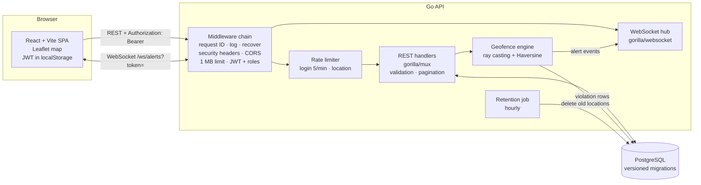
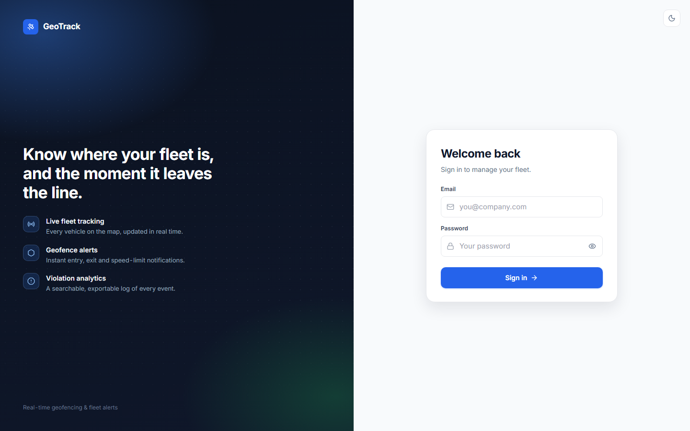
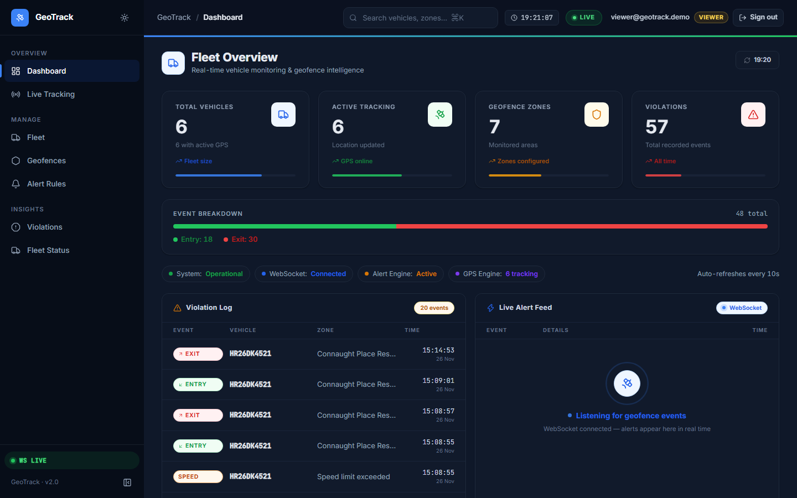
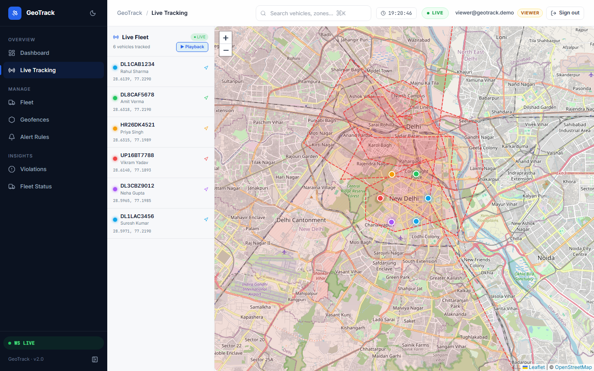
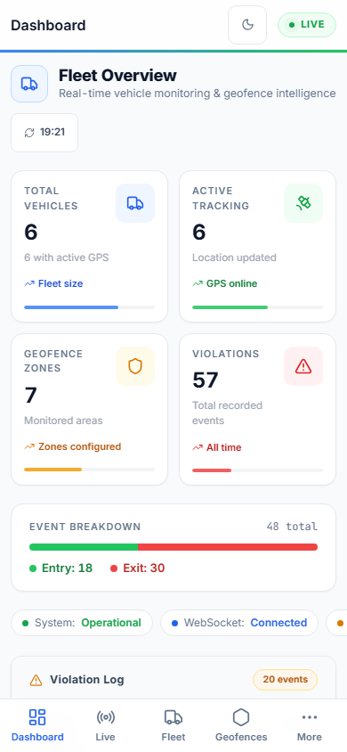
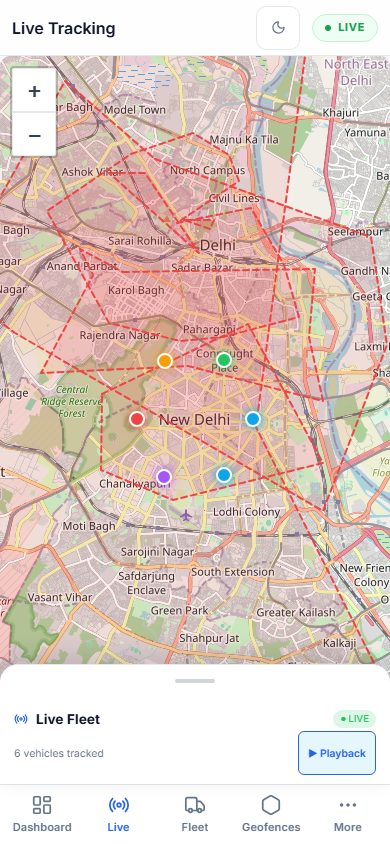

# GeoTrack — Real-Time Geofencing & Fleet Alerts

[](https://github.com/ANJALI01322/Geofencing-Real-time-Alert-System/actions/workflows/ci.yml)


GeoTrack tracks vehicles on a live map, lets you draw polygon geofences, and raises
real-time alerts when a vehicle **enters or exits** a zone or **exceeds the speed limit**.
Alerts are stored in PostgreSQL and pushed to every open browser over a WebSocket.

> ### 🚀 Try it
>
> **Live app:** https://geofencing-real-time-alert-system-umber.vercel.app
>
> | Read-only demo account | |
> |---|---|
> | Email | `viewer@geotrack.demo` |
> | Password | `GeoTrack-Demo-2026` |
>
> Or click **Continue as demo viewer** on the login page. The account can browse everything but cannot change data.
>
> ⏳ Free hosting: the first request can take 30–50 seconds while the server wakes up. Please wait.

## Demo video

Demo video: coming soon

## Live demo

| Part | URL |
|---|---|
| Frontend (Vercel) | https://geofencing-real-time-alert-system-umber.vercel.app |
| API (Render) | https://geofencing-real-time-alert-system-h1vz.onrender.com |
| API health check | https://geofencing-real-time-alert-system-h1vz.onrender.com/health |

> Free hosting par pehli request ko 30-50 second lag sakte hain (server wake-up). Kripya intezaar karein.
>
> The API runs on Render's free tier and sleeps when idle; the UI shows a "Waking up server…" message and retries.

## Features

- **Live tracking map** — every vehicle on a Leaflet map, with a built-in GPS simulator and route playback.
- **Geofence builder** — draw polygons by clicking on the map; zones are colour-coded by category.
- **Entry / exit detection** — each GPS update is checked against every zone (ray casting).
- **Speed violations** — Haversine speed between consecutive fixes, with GPS-jump filtering and a per-vehicle cooldown.
- **Real-time alerts** — WebSocket push with live connection status and automatic reconnect.
- **Alert rules** — choose which vehicle / zone / event combinations trigger live alerts.
- **Violation log** — server-side filters, paginated (50 per page, max 100), consistent totals from a single
  stats endpoint, and CSV export of *every* filtered row.
- **Sign-in with roles** — JWT authentication; `admin` can change data, `viewer` is read-only (the public demo uses one).
- **Fleet status** — vehicles ranked by number of violations.
- **Production touches** — versioned SQL migrations, request validation with one error format, per-IP rate limits,
  security headers, panic recovery, location-data retention, dark mode, error boundary, loading skeletons, request
  IDs and access logs, graceful shutdown, DB-aware health check, unit tests and CI.

## Architecture



**Flow of a location update:** `POST /vehicles/location` (admin token) → rate limit → the previous position is
read → the new position is stored → in the background the engine compares *previous vs current* position
for every geofence (entry/exit) and computes speed → any violation is written to `violations`
and broadcast to all WebSocket clients.

## Tech decisions

**Why Go.** The core work is many small concurrent requests (GPS pings) plus fan-out to WebSocket
clients. Goroutines make "respond to the HTTP request now, run geofence checks in the background"
trivial, the standard library covers HTTP/JSON/testing, and the result is a single small binary
that is cheap to host.

**Why WebSocket.** Alerts must reach the dashboard the moment they happen. Polling would add
latency and waste requests; a WebSocket keeps one connection open and lets the server push.
A central hub goroutine owns the client set and broadcasts each event. The frontend shares a
single connection through a React context and reconnects with exponential backoff (1s → 15s).

**Geofence algorithm.**
- *Point in polygon* — a ray is cast from the point; an odd number of edge crossings means
  the point is inside. Boundaries are half-open (min edges inside, max edges outside), so a
  vehicle on a border is never both inside and outside. Works for concave shapes too.
- *Entry / exit* — computed from two booleans: `!wasInside && isInside` = entry,
  `wasInside && !isInside` = exit. No per-vehicle state needs to be stored; the previous point
  comes from the `vehicle_locations` table.
- *Speed* — Haversine great-circle distance ÷ time between fixes. Readings are ignored when the
  fixes are < 2 s apart or the speed is > 250 km/h (GPS jumps), and a vehicle gets at most one
  speed alert per 60 s.

**PostgreSQL.** Relational data (vehicles, zones, rules, violations) with foreign keys and
cascades; polygon coordinates are stored as JSONB.

## Authentication & roles

Everything except `GET /health` and `POST /auth/login` needs a token. Sign in, then send it on every request:

```bash
API=https://geofencing-real-time-alert-system-h1vz.onrender.com
TOKEN=$(curl -s -X POST $API/auth/login -H "Content-Type: application/json" \
  -d '{"email":"viewer@geotrack.demo","password":"GeoTrack-Demo-2026"}' | python -c "import sys,json;print(json.load(sys.stdin)['data']['token'])")

curl -H "Authorization: Bearer $TOKEN" $API/vehicles
```

| Role | Can do |
|---|---|
| `admin` | everything: read, register vehicles, draw geofences, create alert rules, send GPS updates |
| `viewer` | read only (`GET`). Any `POST`/`PUT`/`DELETE` returns `403 FORBIDDEN`; the UI hides those controls |

The read-only demo account is listed in the **Try it** box at the top. Admin credentials are never published. If you run
your own copy, the demo user exists only when you set `DEMO_VIEWER_EMAIL` and `DEMO_VIEWER_PASSWORD` (see below).

How it works: `POST /auth/login` checks the bcrypt hash and returns an HS256 JWT valid for **1 hour**
(`JWT_SECRET` from the environment). The WebSocket cannot send headers from a browser, so it takes the token as
`/ws/alerts?token=…`. On a missing, invalid or expired token the API answers `401`; the app then clears the
session and returns to the sign-in page.

## API

Successful responses are wrapped as `{ "data": ..., "time_ns": "..." }`. Every response carries an
`X-Request-ID` header (sent back if you provide one).

**Errors** always look the same, with a stable `code` to switch on:

```json
{ "error": { "code": "VALIDATION_ERROR", "message": "latitude must be between -90 and 90" } }
```

| HTTP | `code` | Meaning |
|---|---|---|
| 400 | `VALIDATION_ERROR` | bad input (range, missing field, malformed JSON, invalid UUID / date / event type) |
| 401 | `UNAUTHORIZED` | no, invalid or expired token; wrong email or password |
| 403 | `FORBIDDEN` | signed in, but a `viewer` tried to change data |
| 404 | `NOT_FOUND` | unknown vehicle / zone |
| 409 | `CONFLICT` | e.g. vehicle number already registered |
| 413 | `PAYLOAD_TOO_LARGE` | request body over 1 MB |
| 429 | `RATE_LIMITED` | too many requests (see `Retry-After`) |
| 500 | `INTERNAL_ERROR` | server fault (details are logged, never sent) |

| Method | Endpoint | Role | Description |
|---|---|---|---|
| `GET` | `/health` | public | Service + database status — `{"status":"ok","db":"up"}` (503 if the DB is down) |
| `POST` | `/auth/login` | public | `{email, password}` → `{token, expires_in, user}` (5 attempts/min per IP) |
| `GET` | `/auth/me` | any | The signed-in user |
| `GET` | `/vehicles` | any | List vehicles |
| `POST` | `/vehicles` | admin | Register a vehicle |
| `POST` | `/vehicles/location` | admin | Report a GPS fix; triggers geofence + speed checks |
| `GET` | `/vehicles/location/{vehicle_id}` | any | Latest position, zones it is inside, recent history |
| `GET` | `/geofences` | any | List geofences (optional `?category=`) |
| `POST` | `/geofences` | admin | Create a polygon geofence (≥ 3 vertices, closed ring) |
| `POST` | `/alerts/configure` | admin | Create an alert rule (`entry` / `exit` / `both`) |
| `GET` | `/alerts` | any | List alert rules |
| `GET` | `/violations/history` | any | Paginated violation log (below) |
| `GET` | `/violations/stats` | any | Totals — `{"entry":N,"exit":N,"speed":N}` |
| `GET` | `/violations/summary` | any | Counts per zone and per vehicle over all rows |
| `WS` | `/ws/alerts?token=` | any | Real-time alert stream |

**Pagination.** `GET /violations/history?limit=50&offset=0` — `limit` defaults to 50 and is capped at 100.
Filters: `vehicle_id`, `geofence_id`, `event_type` (`entry` | `exit` | `speed_violation`), `start_date`, `end_date`
(RFC 3339 or `YYYY-MM-DD`). The response `data` holds `violations`, `count` (rows in this page), `total` (rows matching the
filters, across all pages), `limit`, `offset` and `has_more`.

Example location update:

```bash
curl -X POST $API/vehicles/location \
  -H "Authorization: Bearer $ADMIN_TOKEN" -H "Content-Type: application/json" \
  -d '{"vehicle_id":"<uuid>","latitude":28.6139,"longitude":77.2090}'
```

WebSocket alert payload:

```json
{
  "event_id": "evt_…",
  "event_type": "entry",
  "timestamp": "2026-11-26T08:13:04Z",
  "vehicle_id": "…",
  "vehicle_number": "DL01AB1234",
  "driver_name": "Rahul Kumar",
  "latitude": 28.5961,
  "longitude": 77.1973,
  "geofence_name": "Restricted Zone A",
  "speed_kmh": 92.4
}
```

`geofence_name` is `null` and `speed_kmh` is present for `speed_violation` events.

## Local setup

**Prerequisites:** Go 1.21+, Node 20+, and either Docker or a local PostgreSQL.

```bash
git clone https://github.com/ANJALI01322/Geofencing-Real-time-Alert-System.git
cd Geofencing-Real-time-Alert-System

# 1. Database + API with Docker (the API needs the auth variables, see "Environment variables")
export JWT_SECRET=$(openssl rand -hex 32)
export ADMIN_EMAIL=you@example.com ADMIN_PASSWORD='choose-a-strong-password'
docker compose up --build -d          # API on http://localhost:8080

# …or run the API directly against your own Postgres
cd backend
cp .env.example .env                  # edit DATABASE_URL, then export the variables
go run .

# 2. Frontend
cd frontend
cp .env.example .env.local
npm install
npm run dev                           # http://localhost:5173
```

Sign in with the `ADMIN_EMAIL` / `ADMIN_PASSWORD` you exported. The schema is created automatically on startup by the
versioned migrations in `backend/db/migrations/` (`schema_migrations` records what has been applied).

### Tests

```bash
cd backend && go vet ./... && go test ./...   # geofence, speed, auth + roles, validation, rate limiter, pagination, migrations
cd frontend && npm run build
```

CI (`.github/workflows/ci.yml`) runs the same checks on every push.

## Environment variables

**Backend** (`backend/.env.example`)

| Variable | Required | Default | Description |
|---|---|---|---|
| `DATABASE_URL` | yes (prod) | local Postgres DSN | PostgreSQL connection string |
| `PORT` | no | `8080` | HTTP port |
| `CORS_ORIGINS` | recommended | allow all (with a warning) | Comma-separated allowed origins, e.g. `https://your-app.vercel.app` |
| `JWT_SECRET` | **yes (prod)** | random per process (with a warning) | Signing key for tokens, **at least 32 characters**. Without it logins are lost on every restart. Generate: `openssl rand -hex 32` |
| `ADMIN_EMAIL`, `ADMIN_PASSWORD` | **yes (first run)** | none | Creates the admin account if it does not exist (password ≥ 8 chars). Never logged. |
| `DEMO_VIEWER_EMAIL`, `DEMO_VIEWER_PASSWORD` | no | none | Creates a read-only demo account if it does not exist |
| `RETENTION_DAYS` | no | `7` | Delete `vehicle_locations` older than this many days (checked hourly). `0` keeps everything |
| `LOCATION_RATE_PER_MIN` | no | `600` | Per-IP rate limit for `POST /vehicles/location` |
| `TRUSTED_PROXY_HOPS` | no | `1` on Render, else `0` | Reverse proxies in front of the API, used to find the real client IP for rate limiting |

Existing accounts are never modified by these variables. To reset a password, delete the row
(`DELETE FROM users WHERE email = '…'`) and restart.

**Frontend** (`frontend/.env.example`, read at build time)

| Variable | Required | Default | Description |
|---|---|---|---|
| `VITE_API_URL` | yes (prod) | `http://localhost:8080` | API base URL |
| `VITE_WS_URL` | no | derived from `VITE_API_URL` | WebSocket URL (`wss://` on HTTPS sites) |
| `VITE_DEMO_EMAIL`, `VITE_DEMO_PASSWORD` | no | none | Shows a "Continue as demo viewer" button on the login page. Only use credentials of the **read-only** demo account: they end up in the public JavaScript bundle |

## Screenshots

Captured from the [live deployment](https://geofencing-real-time-alert-system-umber.vercel.app), signed in as the demo viewer.

### Desktop

| Sign in | Dashboard |
|---|---|
|  |  |

| Dashboard (dark mode) | Live tracking |
|---|---|
|  |  |

| Geofences | Violation log |
|---|---|
|  |  |

### Mobile (390 × 844)

| Dashboard | Live tracking |
|---|---|
|  |  |

## Project structure

```
backend/
  main.go            router, middleware chain, rate limiters, graceful shutdown, /health
  auth/              JWT issue/verify, bcrypt, role middleware, account seeding
  apierr/            the single error format
  handlers/          REST handlers, validation, pagination, geofence + speed processing
  geo/               point-in-polygon + entry/exit transition (with tests)
  middleware/        request ID, access logging, panic recovery, security headers, body limit, rate limiter
  ws/                WebSocket hub
  db/                connection, migration runner, retention job
  db/migrations/     versioned SQL: 0001 baseline, 0002 users, 0003 indexes
  scripts/           manual maintenance SQL (demo-data cleanup / polish)
frontend/src/
  pages/             Login, Dashboard, Live Tracking, Fleet, Geofences, Alert Rules, Violations, Fleet Status
  components/        Sidebar, Header, BottomNav, Pager, ErrorBoundary, empty/error states
  context/           AuthContext (session, role) and the shared WebSocket (AlertSocketContext)
  auth/              token storage + expiry
  api/               Axios client: auth header, 401 handling, retry + cold-start handling
  styles/theme.css   design tokens, light/dark themes
```

## Security

- **Authentication on everything but `/health` and `/auth/login`.** The middleware fails closed: a route is protected unless it
  is explicitly listed as public. Roles are enforced on the server; hiding buttons in the UI is only a convenience.
- **Passwords** are stored as bcrypt hashes (cost 12), never logged or returned. Login answers "Invalid email or password"
  for both an unknown email and a wrong password, and spends the same time on both.
- **Tokens** are HS256 JWTs that expire after 1 hour; `none` and other algorithms are rejected, and the signing secret comes
  only from `JWT_SECRET` (a too-short secret stops the server from starting).
- **Rate limiting** (token bucket per client IP): 5 sign-in attempts per minute, and a ceiling on GPS updates. Over the limit → `429` with `Retry-After`.
- **Input validation** returns `400` with a clear message instead of a database error: latitude/longitude ranges, polygon
  shape, trimmed non-empty fields with length limits, UUID format, whitelisted event types and dates. All SQL uses bind parameters.
- **Hardening:** request bodies are capped at 1 MB, responses carry `X-Content-Type-Options`, `X-Frame-Options`, `Referrer-Policy`
  and `Cache-Control: no-store`, a panic becomes a logged JSON `500`, and `5xx` responses never include internal details.
- **Secrets stay out of the repo and the logs:** the database URL, `JWT_SECRET`, passwords and the WebSocket `?token=` are never
  logged (the access log records the path only).
- **Trade-off:** the browser keeps the token in `localStorage` so a refresh keeps you signed in. That is safe only while the app has
  no XSS hole (React escapes output; there is no `dangerouslySetInnerHTML`). Tokens are not revocable before they expire.

## Scaling notes

- **Database:** indexes on the hot paths (`violations(event_type, timestamp)`, `violations(vehicle_id, timestamp)`,
  `vehicle_locations(vehicle_id, timestamp)`); redundant ones are dropped to keep the constant stream of location inserts cheap.
  `vehicle_locations` is the table that grows, so rows older than `RETENTION_DAYS` are deleted hourly in small batches.
- **Pagination** uses `LIMIT/OFFSET` with a stable `(timestamp, id)` order. For very deep pages, switch to keyset pagination.
- **Several API instances:** migrations take a Postgres advisory lock, so a rolling deploy cannot apply one twice. Three things are still
  per-process and need shared state first (Redis): the rate limiter, the speed-alert cooldown, and the WebSocket hub (every instance
  would only broadcast to its own clients).
- **Geofence checks** scan every zone per update; PostGIS with a spatial index would scale that to thousands of zones.

## Future work

- **Refresh tokens + httpOnly cookies** — silent session renewal instead of signing out after an hour, and no token in `localStorage`.
- **Redis pub/sub** — so the WebSocket hub, rate limiter and speed cooldown work across multiple API instances.
- **PostGIS spatial queries** — spatial indexes instead of scanning every zone on each GPS update.
- **Prometheus monitoring** — request, latency and WebSocket metrics with alerting.
- **End-to-end tests** — browser tests (e.g. Playwright) for sign-in, live alerts and the role restrictions.
