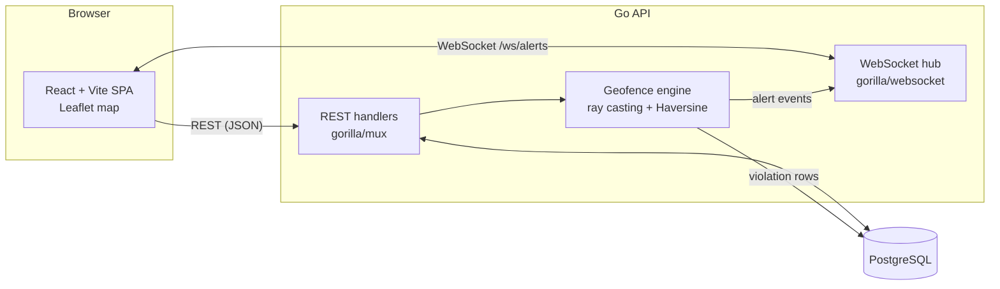
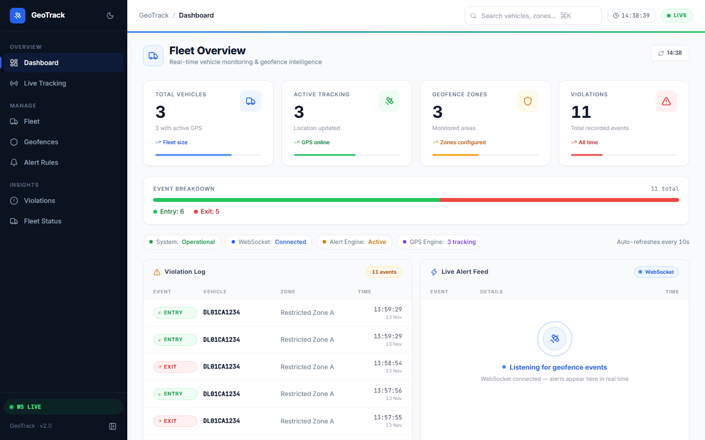
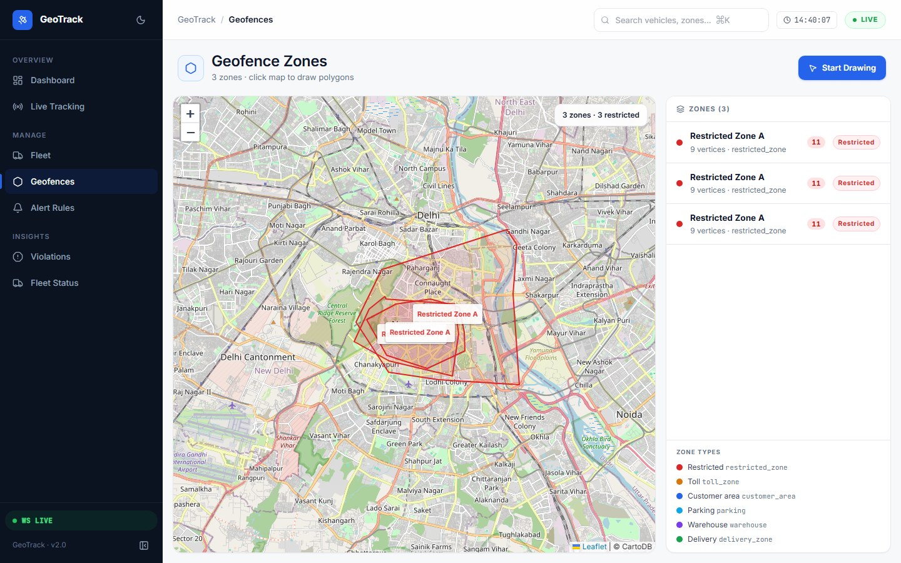
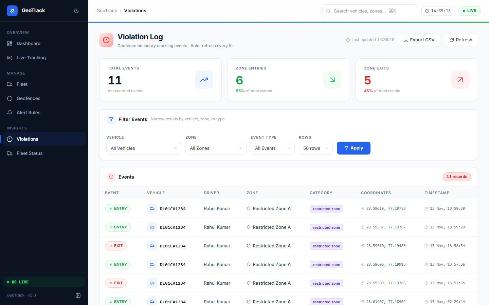

# GeoTrack — Real-Time Geofencing & Fleet Alerts

[](https://github.com/ANJALI01322/Geofencing-Real-time-Alert-System/actions/workflows/ci.yml)


GeoTrack tracks vehicles on a live map, lets you draw polygon geofences, and raises
real-time alerts when a vehicle **enters or exits** a zone or **exceeds the speed limit**.
Alerts are stored in PostgreSQL and pushed to every open browser over a WebSocket.

## Live demo

| Part | URL |
|---|---|
| Frontend (Vercel) | _add your Vercel deployment URL here_ |
| API (Render) | https://geofencing-real-time-alert-system-h1vz.onrender.com |
| API health check | https://geofencing-real-time-alert-system-h1vz.onrender.com/health |

> The API runs on Render's free tier and sleeps when idle. The first request after a
> pause can take ~30 seconds; the UI shows a "Waking up server…" message and retries.

## Features

- **Live tracking map** — every vehicle on a Leaflet map, with a built-in GPS simulator and route playback.
- **Geofence builder** — draw polygons by clicking on the map; zones are colour-coded by category.
- **Entry / exit detection** — each GPS update is checked against every zone (ray casting).
- **Speed violations** — Haversine speed between consecutive fixes, with GPS-jump filtering and a per-vehicle cooldown.
- **Real-time alerts** — WebSocket push with live connection status and automatic reconnect.
- **Alert rules** — choose which vehicle / zone / event combinations trigger live alerts.
- **Violation log** — server-side filters, consistent totals from a single stats endpoint, CSV export.
- **Fleet status** — vehicles ranked by number of violations.
- **Production touches** — dark mode, error boundary, loading skeletons, request IDs and access logs,
  graceful shutdown, DB-aware health check, unit tests and CI.

## Architecture



**Flow of a location update:** `POST /vehicles/location` → the previous position is read →
the new position is stored → in the background the engine compares *previous vs current* position
for every geofence (entry/exit) and computes speed → any violation is written to `violations`
and broadcast to all WebSocket clients.

## Tech decisions

**Why Go.** The core work is many small concurrent requests (GPS pings) plus fan-out to WebSocket
clients. Goroutines make "respond to the HTTP request now, run geofence checks in the background"
trivial, the standard library covers HTTP/JSON/testing, and the result is a single small binary
that is cheap to host.

**Why WebSocket.** Alerts must reach the dashboard the moment they happen. Polling would add
latency and waste requests; a WebSocket keeps one connection open and lets the server push.
A central hub goroutine owns the client set and broadcasts each event. The frontend shares a
single connection through a React context and reconnects with exponential backoff (1s → 15s).

**Geofence algorithm.**
- *Point in polygon* — a ray is cast from the point; an odd number of edge crossings means
  the point is inside. Boundaries are half-open (min edges inside, max edges outside), so a
  vehicle on a border is never both inside and outside. Works for concave shapes too.
- *Entry / exit* — computed from two booleans: `!wasInside && isInside` = entry,
  `wasInside && !isInside` = exit. No per-vehicle state needs to be stored; the previous point
  comes from the `vehicle_locations` table.
- *Speed* — Haversine great-circle distance ÷ time between fixes. Readings are ignored when the
  fixes are < 2 s apart or the speed is > 250 km/h (GPS jumps), and a vehicle gets at most one
  speed alert per 60 s.

**PostgreSQL.** Relational data (vehicles, zones, rules, violations) with foreign keys and
cascades; polygon coordinates are stored as JSONB.

## API

All responses are wrapped as `{ "data": ..., "time_ns": "..." }`. Every response carries an
`X-Request-ID` header (sent back if you provide one).

| Method | Endpoint | Description |
|---|---|---|
| `GET` | `/health` | Service + database status — `{"status":"ok","db":"up"}` (503 if the DB is down) |
| `GET` | `/vehicles` | List vehicles |
| `POST` | `/vehicles` | Register a vehicle |
| `POST` | `/vehicles/location` | Report a GPS fix; triggers geofence + speed checks |
| `GET` | `/vehicles/location/{vehicle_id}` | Latest position, zones it is inside, recent history |
| `GET` | `/geofences` | List geofences (optional `?category=`) |
| `POST` | `/geofences` | Create a polygon geofence |
| `POST` | `/alerts/configure` | Create an alert rule (`entry` / `exit` / `both`) |
| `GET` | `/alerts` | List alert rules |
| `GET` | `/violations/history` | Violation log (filters: `vehicle_id`, `geofence_id`, `event_type`, `start_date`, `end_date`, `limit` ≤ 500) |
| `GET` | `/violations/stats` | Totals — `{"entry":N,"exit":N,"speed":N}` |
| `WS` | `/ws/alerts` | Real-time alert stream |

Example location update:

```bash
curl -X POST https://geofencing-real-time-alert-system-h1vz.onrender.com/vehicles/location \
  -H "Content-Type: application/json" \
  -d '{"vehicle_id":"<uuid>","latitude":28.6139,"longitude":77.2090}'
```

WebSocket alert payload:

```json
{
  "event_id": "evt_…",
  "event_type": "entry",
  "timestamp": "2026-11-26T08:13:04Z",
  "vehicle_id": "…",
  "vehicle_number": "DL01AB1234",
  "driver_name": "Rahul Kumar",
  "latitude": 28.5961,
  "longitude": 77.1973,
  "geofence_name": "Restricted Zone A",
  "speed_kmh": 92.4
}
```

`geofence_name` is `null` and `speed_kmh` is present for `speed_violation` events.

## Local setup

**Prerequisites:** Go 1.21+, Node 20+, and either Docker or a local PostgreSQL.

```bash
git clone https://github.com/ANJALI01322/Geofencing-Real-time-Alert-System.git
cd Geofencing-Real-time-Alert-System

# 1. Database + API with Docker
docker compose up --build -d          # API on http://localhost:8080

# …or run the API directly against your own Postgres
cd backend
cp .env.example .env                  # edit DATABASE_URL, then export the variables
go run .

# 2. Frontend
cd frontend
cp .env.example .env.local
npm install
npm run dev                           # http://localhost:5173
```

The schema is created automatically on startup.

### Tests

```bash
cd backend && go vet ./... && go test ./...   # geofence, speed, transitions, middleware
cd frontend && npm run build
```

CI (`.github/workflows/ci.yml`) runs the same checks on every push.

## Environment variables

**Backend** (`backend/.env.example`)

| Variable | Required | Default | Description |
|---|---|---|---|
| `DATABASE_URL` | yes (prod) | local Postgres DSN | PostgreSQL connection string |
| `PORT` | no | `8080` | HTTP port |
| `CORS_ORIGINS` | recommended | allow all (with a warning) | Comma-separated allowed origins, e.g. `https://your-app.vercel.app` |

**Frontend** (`frontend/.env.example`, read at build time)

| Variable | Required | Default | Description |
|---|---|---|---|
| `VITE_API_URL` | yes (prod) | `http://localhost:8080` | API base URL |
| `VITE_WS_URL` | no | derived from `VITE_API_URL` | WebSocket URL (`wss://` on HTTPS sites) |

## Screenshots

| Dashboard | Dark mode |
|---|---|
|  |  |

| Geofences | Violation log |
|---|---|
|  |  |

## Project structure

```
backend/
  main.go            router, CORS, graceful shutdown, /health
  handlers/          REST handlers, geofence + speed processing
  geo/               point-in-polygon + entry/exit transition (with tests)
  middleware/        request ID, access logging, CORS origin parsing
  ws/                WebSocket hub
  db/                connection + schema migration
  scripts/           manual maintenance SQL (demo-data cleanup)
frontend/src/
  pages/             Dashboard, Live Tracking, Fleet, Geofences, Alert Rules, Violations, Fleet Status
  components/        Sidebar, Header, ErrorBoundary, empty/error states
  context/           shared WebSocket connection (AlertSocketContext)
  api/               Axios client with retry + cold-start handling
  styles/theme.css   design tokens, light/dark themes
```

## Known limitations / future work

- **No authentication** — every endpoint is public. Next step: JWT auth with per-organisation data.
- **Speed cooldown is in memory** — it resets on restart and isn't shared across multiple API instances (Redis would fix that).
- **WebSocket accepts any origin** — `CORS_ORIGINS` covers REST only; the WS origin check is still open.
- **One shared alert stream** — every client receives every alert; per-user subscriptions would scale better.
- **Geofence checks scan all zones** — fine for tens of zones; PostGIS with a spatial index would scale to thousands.
- **Simulated GPS** — locations come from the in-browser simulator, not real devices.
- **Free-tier hosting** — cold starts on Render; a paid instance or a keep-alive ping would remove them.
